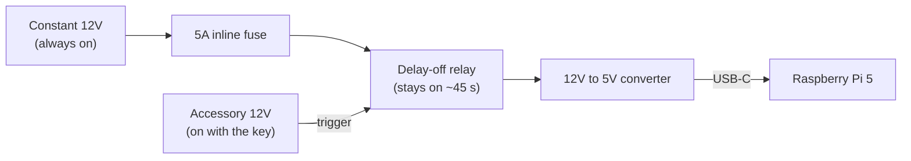
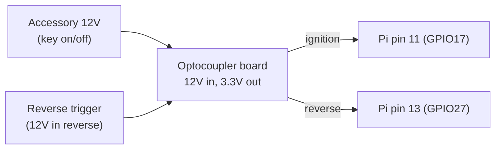

# Car wiring guide

How the Car PC connects to the 2011 Honda Civic: power, the ignition and reverse signals, audio, and
USB devices. Written for a first-time builder. **Verify every part against this guide before buying,
and update this file whenever a part turns out different from what's described here.**

*Last updated: October 2026, before any car wiring was done. Parts marked "ordered" or "have" are
confirmed; everything else is planned.*

---

## The big picture

- **Key on:** the accessory wire switches the delay relay on. Constant 12V flows through the fuse and
  relay into the converter, and the Pi boots.
- **Key off:** the Pi notices (see the signal path below) and shuts itself down. The relay keeps power
  flowing for about 45 more seconds so the shutdown can finish, then cuts power completely, so nothing
  drains the battery.

The car's 12V would instantly destroy the Pi's pins, which only handle 3.3V. The **optocoupler** sits
between them: a tiny light inside turns on when 12V arrives, and a light sensor on the other side flips
the Pi's pin. The two sides never touch electrically, so a voltage spike from the car can't reach the Pi.

---

## 1. Where the wires come from

The current aftermarket head unit already has every wire needed, on its **wiring harness behind the
dash** (standard aftermarket colors):

| Wire | Usual color | What it does |
|---|---|---|
| Constant 12V | Yellow | Live even with the key out |
| Accessory 12V | Red | Live only with the key in ACC or ON |
| Ground | Black | Car ground |
| Reverse trigger | Varies | The wire the current unit gets from the backup camera; 12V only in reverse |

Tap these with **Posi-Taps**, which clamp onto the existing wire without cutting it, so the current head
unit keeps working. **Never trust colors: confirm every wire with a multimeter (section 4).**

## 2. Power path

1. **Yellow (constant) → inline fuse holder with a 5A fuse**, as close to the tap as possible.
2. **Fuse → the delay relay's power input and its switched contact. Red (accessory) → the relay's
   trigger input.** Set the relay to "delay off", about 45 seconds.
3. **Relay output → the 12V→5V converter's input. Converter's USB-C → the Pi.**
4. **Every ground (relay, converter) → the black wire**, or bare metal on the car body.

The relay module and converter models aren't chosen yet. Check them with Claude before buying: the
relay's terminal names and delay mode differ between modules.

## 3. Signal path (ignition and reverse)

**Car side of the optocoupler board:**
- Channel 1 input → **red (accessory)**.
- Channel 2 input → **the reverse trigger wire**.
- The board's input ground → car ground.

**Pi side of the optocoupler board:**

| Board terminal | Pi pin |
|---|---|
| Output power (VCC) | **Pin 1** (3.3V), never 5V |
| Output ground | **Pin 9** (GND) |
| Output 1 (ignition) | **Pin 11** (GPIO17) |
| Output 2 (reverse) | **Pin 13** (GPIO27) |

Optocoupler boards label their terminals differently. When the board arrives, photograph both sides so
the terminals can be matched to this table, and note the board's input voltage rating (it must say 12V,
or 12-24V).

## 4. Identifying wires with a multimeter

Set the multimeter to **DC volts (20V range)**. Put the black probe on bare metal and the red probe on
the wire you're checking:

| Wire | Key out | Key on | In reverse |
|---|---|---|---|
| Constant (yellow) | ~12V | ~12V | ~12V |
| Accessory (red) | 0V | ~12V | ~12V |
| Reverse trigger | 0V | 0V | ~12V |

With the engine running, expect about 13.5-14.5V instead of 12V. That's normal.

## 5. Everything else (plugging in, no wiring)

- **Sound:** USB audio adapter (ENVEL, have) headphone jack → 3.5mm aux cable (have) → the stereo's
  aux input. Set the Pi's volume to about 80-90% once (Music page), then use the stereo's knob.
- **Microphone:** PC clip-on mic with a TRS plug (ordered) → the adapter's **mic** jack. The first
  mic (FingerLakes car mic, mono TS plug) got no power from this adapter.
- **Backup camera:** the camera's 3.5mm TRRS plug → 4-pole female-to-female coupler → Riksoin 3.5mm
  to 3 RCA cable → USB composite capture dongle (Linux/UVC compatible). The video may come out of the
  red or white RCA plug instead of yellow, so try each.
- **USB devices:** USB GPS (VK-162), capture dongle, dashcam (UGREEN camera, have), audio adapter and
  the phone go into a **powered USB hub** fed from the same 5V converter.

## 6. Order of work

1. **Bench first, at home.** Wire the relay, converter and optocoupler using a **12V wall power
   supply** (12V, 2A or more) as a stand-in car. Test the ignition and reverse signals and the
   automatic shutdown at the desk before anything touches the car.
2. **In the car:** disconnect the **negative battery terminal** before tapping anything. Make the
   taps, reconnect the battery, and test every wire with the multimeter.
3. Drive with it for a while, then tidy the wiring with zip ties and cloth harness tape.

## Safety rules

- **Never let 12V touch a Pi pin.** Only the optocoupler's input side connects to the car.
- **Fuse every new wire** added from a 12V source.
- **Don't probe the yellow connectors** on the steering column and under the seats. Those are
  **airbag** wiring.
- Test new wiring on the bench before it goes in the car.

## Extra parts for the wiring

| Part | Status |
|---|---|
| 12V delay-off relay module (delay off, adjustable) | Planned, verify model first |
| 12V→5V 5A USB-C converter (Pi 5 compatible) | Planned, verify model first |
| 2-channel PC817 optocoupler board, 12V input | Planned |
| Posi-Taps, mixed pack | Planned |
| Inline fuse holder + 5A fuses | Planned |
| 18 AWG wire (power) and 22 AWG wire (signals) | Planned |
| Heat-shrink tubing | Planned |
| Female-to-female jumper wires (for the Pi's pins) | Planned |
| Multimeter | Planned (if you don't have one) |
| 12V wall power supply, 2A or more (bench testing) | Planned |
| Ground loop isolator | Only if engine whine is heard |

## Videos

**2006–2011 Civic, getting behind the dash:**
- [How To Remove Honda Civic Radio (2006-2011) & Install Touch Screen](https://www.youtube.com/watch?v=SLDPzk4C6e0)
- [2006-2011 Honda Civic CarPlay & Android Radio Upgrade Install: Step-by-Step](https://www.youtube.com/watch?v=O8Y_MnaAqpw)

**Multimeter and finding constant and ignition wires:**
- [How To Use a Multimeter - Test Car Voltage](https://www.youtube.com/watch?v=h5Rl5OW8wOc)
- [How to find and test for 12 volt constant](https://www.youtube.com/watch?v=jubTdDp5zN4)
- [How To Find a 12V Power Ignition Source](https://www.youtube.com/watch?v=_HAKnVv1Tf4)

**Posi-Taps:**
- [How to Use Posi-Taps for Automotive Wiring](https://www.youtube.com/watch?v=PqZd9hF3cEU)
- [Posi-Tap Reversing Camera Installation: Find & Tap the Reverse Light Wire](https://www.youtube.com/watch?v=CSDn6wHYFMc)

**Delay-off relays:**
- [Beuler BU-509TD Time Delay Relay – Delay Off](https://www.youtube.com/watch?v=oJEsI2TRaLk) (automotive-style)
- [How to use 12V timer delay relay: circuit and wire diagram](https://www.youtube.com/watch?v=Bn-DAY1UAcc) (cheap module type)

**Optocouplers (PC817):**
- [Using Optocouplers with the Raspberry Pi](https://www.youtube.com/watch?v=pYENAGK8qH4)
- [PC817 Optocoupler Explained](https://www.youtube.com/watch?v=CBYQgBXUfwY)

These were picked from search results by title and description, not watched. Skip any that turn out
unhelpful; the topics are what matter.

---

## Change log

- **Oct 2026:** First version. The audio adapter, aux cable and dashcam camera are in hand, and the TRS
  PC mic is ordered (the mono car mic didn't work with the adapter).
